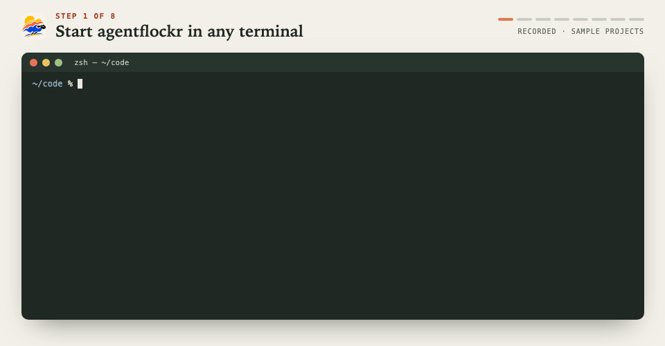

# AgentFlockr

<p align="left">
  <picture>
    <source media="(prefers-color-scheme: dark)" srcset="assets/wordmark-inverse.svg">
    
  </picture>
</p>

**Keep an eye on the flock.**

agentflockr puts your Claude Code, Codex and OpenCode V2 sessions in one
terminal dashboard. Sessions waiting for input or reporting an error come
first, so you can see which ones need you.

## At a glance

- **Keep starting your agents as usual.** agentflockr picks up their sessions,
  including older ones from before you installed it.
- **Find any session.** Search by project, title, latest activity, folder or ID.
- **No API keys.** Works with the subscriptions you already have, with no wrapper.
- **Reads your configuration.** If your agents are set up on your computer, agentflockr can watch them.
- **Stays on your machine.** No account, no relay, no telemetry, and no AI model of its
  own. agentflockr makes no network requests of its own; it reads local files and
  runs your agents' CLIs, `tmux` and `ps`. What those programs do is up to them.
  [See exactly what it reads and writes.](#what-it-reads-and-writes)
- **Open any session.** Use its agent's own CLI, or the tmux pane already running it, and
  come back to the dashboard when you leave.
- **Move projects.** Point agentflockr at a project's new folder and keep its sessions:
  each agent resumes there.
- **Delete sessions.** Permanently, through the agent's own command where it has one, or
  only remove them from agentflockr.
- **Create new sessions.** Start one from a project in the dashboard, choosing the agent,
  profile, model and effort.
- **Terminal first, macOS and Linux.** Not tied to an IDE or a MacBook notch.
- **Calm by design.** One attention sort and evidence for every status, not a manager
  model or a wall of panes.

[](LICENSE)


[Install](#install) · [Usage](#usage) · [Settings](#settings) · [How it works](#how-it-works) · [What it reads and writes](#what-it-reads-and-writes) · [Not yet](#not-yet) · [Alternatives](#alternatives) · [Who wrote the code](#who-wrote-the-code) · [Contributing](#contributing) · [License](#license) · [Credits](#inspiration-and-credits)

## Supported agents

| | OpenCode V2 | Codex | Claude Code |
|---|---|---|---|
| Sessions read from | `opencode api` | `~/.codex` | `~/.claude` and every `~/.claude-*` profile |
| Discover and open | ✅ | ✅ | ✅ |
| Move and delete | ✅ | ✅ | ✅ |

OpenCode V2 is read through its `opencode api` command, which finds and signs
in to the local OpenCode service.

## Install

You'll need macOS or Linux, with your agent CLIs on `PATH`.

```sh
curl -fsSL https://raw.githubusercontent.com/psicomante/agentflockr/main/install.sh | sh
```

The installer downloads the latest release for your system, checks its
checksum and puts `agentflockr` in `~/.local/bin`. Run it again to update.
Set `AGENTFLOCKR_VERSION` to a release tag for a specific version, or
`AGENTFLOCKR_INSTALL_DIR` to install somewhere else.

If `~/.local/bin` is not on your `PATH`, add `export PATH="$HOME/.local/bin:$PATH"`
to your shell configuration and open a new terminal.

Archives are also on the [Releases](https://github.com/psicomante/agentflockr/releases)
page. macOS binaries aren't signed. If you download one through a browser,
clear the quarantine flag with `xattr -d com.apple.quarantine agentflockr`
before running it.

### Build from source

Requirements: Go 1.26+:

```sh
git clone https://github.com/psicomante/agentflockr.git
cd agentflockr
make install
```

`make install` also uses `~/.local/bin`. To change it, use
`make install LOCAL_BIN=/path/to/bin`.

With Go installed you can also skip the clone:

```sh
go install github.com/psicomante/agentflockr/cmd/agentflockr@latest
```

`agentflockr --version` then reports the module version Go recorded.

## Usage



```sh
agentflockr          # Open the dashboard
agentflockr --demo   # Sample sessions; doesn't read or change your data
```

Press Enter to open a session in its agent's CLI. If agentflockr can find a
tmux pane already running that session, it opens the pane instead. When you
exit the agent's CLI, you're back at the dashboard.

Use `/` to search by project, title, latest activity, folder or ID.

| Key | Action |
|---|---|
| `↑` `↓`, `j` `k` | Move the selection |
| `Tab` | Switch between sessions and projects |
| `Enter` | Open the selected session, or list a project's sessions |
| `/` | Search titles, latest activity, folders and IDs |
| `a` | Filter the list by agent |
| `Esc` | Clear filters or leave a project |
| `n` | Start a new session in the selected project |
| `m` | Update the project's folder after you've moved it |
| `x` | Remove the session or project from agentflockr |
| `d` | Permanently delete the session's history |
| `r` | Refresh now |
| `!` | Show where sessions are read from and any problems found |
| `?` | Show all keys and explain the statuses |
| `q` | Quit |

`m`, `x` and `d` ask for confirmation. `x` removes a session or project from
agentflockr but keeps the agent's history. `d` deletes a session's history
permanently.

Move a project's folder yourself, then use `m` to tell agentflockr where it
is now. Its sessions will open there.

### Session status

The header counts waiting and failed sessions. The details show what each
status is based on.

| Status | Meaning |
|---|---|
| ● waiting | The agent needs permission, an answer or other input. |
| ✕ failed | The last turn reported an error. |
| ◐ working | A turn is running. |
| ✓ done | The last turn finished. It doesn't mean the work is right. |
| ○ idle | No turn is running. |
| ◌ unknown | No reliable status information. |

A working or waiting status based on a transcript becomes unknown after two
minutes without an update. Set `stale-after` in the settings file to change
that timeout.

## Settings

`agentflockr --help` lists all options. Use `--providers` to choose which
agents to watch, `--refresh` to change the refresh interval (five seconds by
default), or `--data-dir` to store the index somewhere else.

Use `--codex-home` or `--claude-home` if your agent data lives somewhere else.
Setting a Claude home makes agentflockr read only that home, without the
other profiles.

Save settings in `~/.config/agentflockr/agentflockr.toml`, for example:

```toml
providers = ["codex", "claude"]
refresh = "10s"
recent-window = "48h"   # Cutoff between RECENT and EARLIER

[codex]
stale-after = "10m"     # Useful for long test runs with no transcript updates

[[claude.profiles]]     # Claude Code accounts offered for new sessions
name = "work"
home = "~/.claude-work"
command = ["claude-work"]   # Optional; the default is ["claude"]
```

Each profile's home is also read for sessions. A shell alias such as
`alias cw='CLAUDE_CONFIG_DIR=~/.claude-work claude --verbose'` becomes
`home = "~/.claude-work"` and `command = ["claude", "--verbose"]`. A command
must be a name on `PATH`, an absolute path or a path starting with `~/`.

`agentflockr --print-config` prints the current settings as TOML. You can
copy its output into the settings file.

Flags override environment variables, which override the file. If a setting
is misspelled or invalid, agentflockr stops and tells you which one.

## How it works

agentflockr reads the transcripts and state files that Claude Code and Codex
keep on disk. For OpenCode, it uses `opencode api`, which finds and signs in
to the local service.

It reads transcripts incrementally, and reads several at once, one per core, so
a long history is ready quickly after startup. Until the first refresh ends, the
dashboard shows what the index already holds. A refresh doesn't make moves or
deletions wait: only their brief write to the index does.

Its index is `sessions.db` in `~/.local/share/agentflockr`, readable only by
you. If `XDG_DATA_HOME` is set, it goes in `$XDG_DATA_HOME/agentflockr`
instead. You can also set `AGENTFLOCKR_DATA_DIR` or pass `--data-dir`.

It leaves the agents' data alone except when you confirm a deletion, or when
you open an OpenCode session after updating its project's folder.

Session data stays on your machine. There's no account, relay, telemetry or
background AI model. agentflockr doesn't start agents in worktrees, run them
in the cloud or replace their interfaces.

## What it reads and writes

An audit of the code (2026-11-01) found the following. Nothing here needs a
network.

**Network.** agentflockr makes no network requests. It has no HTTP client and
never opens a connection. The only calls to a service go through the
`opencode api` command, which talks to your local OpenCode service. The agents
you open, and `codex debug models` (which fills the model list of the new
session form), do what they do on their own. The installer, `install.sh`, is
separate from the program and downloads a release from GitHub when you run it.

**What it reads:**

| What | From |
|---|---|
| Claude Code transcripts and live status | `~/.claude/projects/*/*.jsonl` and `~/.claude/sessions/*.json`, and the same in each `~/.claude-*` profile |
| Codex transcripts | `~/.codex/sessions` and `~/.codex/archived_sessions` |
| Codex profile names | The file names `NAME.config.toml` in `~/.codex`. It never opens them. |
| OpenCode sessions | `opencode api`, only |
| Settings | `~/.config/agentflockr/agentflockr.toml`, or the file you name |
| Project folders | Whether each exists, and the folders you browse when moving a project |
| Running processes | `ps`, when you open a session and tmux has panes: the arguments of every process, matched against the session and then dropped |
| tmux | The list of panes, at the same time |
| Clipboard | Only when you press `ctrl+v` in a text field (`pbpaste` on macOS; `xclip`, `xsel` or `wl-paste` on Linux) |

It bounds what it reads from an agent: a transcript record up to 16 MiB, a
status file 1 MiB, a command's output 64 MiB.

**What it writes:**

| What | Where | When |
|---|---|---|
| Its index | `sessions.db` in the data folder (`0600`, in a `0700` folder) | Every run except `--demo`, `--version`, `--help` and `--print-config` |
| Claude Code: deletes a session's transcript and subagent folder | Inside that session's project folder only | After you confirm with `d`, and only if no live process owns the session |
| Codex: deletes a session | `codex delete --force`, with `CODEX_HOME` set to the configured home | After you confirm with `d` |
| OpenCode: deletes a session | `opencode api` | After you confirm with `d`, and not while a turn runs |
| OpenCode: moves a session, or creates one | `opencode api` | When you open a session after moving its project; when you start one through a connection with a chosen model |
| tmux focus | `select-window`, `select-pane`, then `attach-session` or `switch-client` | When you open a session already running in a pane |

The index holds what it needs to list sessions, including each one's title and
an excerpt of its last reply (up to 600 characters). It keeps them after the
agent's own copy is gone, until you delete or remove the session from
agentflockr. It never writes the settings file, a log or anything in the
folder you start it from.

Two settings of the terminal library can write files when you set them:
`TEA_TRACE=PATH` appends a debug trace to PATH, and `TEA_DEBUG=1` writes
`bubbletea-panic-TIME.log` in the current folder if agentflockr crashes.
agentflockr never sets either.

To check the network claim yourself:

```sh
go list -deps ./cmd/agentflockr | grep -E '^net'
go build -o /tmp/agentflockr ./cmd/agentflockr
go tool nm /tmp/agentflockr | grep -E ' T net\.(Dial|\(\*Dialer\)|Listen|\(\*Resolver\))|net/http\.'
```

The first command lists the `net` package, which the SQLite runtime pulls in
but nothing uses to connect. The last prints nothing.

## Not yet

- **Phone notifications and short replies.** Through `agentflockr serve`, over your own
  Tailscale network, with no account or relay.
- **Sound alerts.** When a session starts waiting or finishes.
- **More themes.** Beyond the light and dark palettes that follow your terminal.
- **More agents.** Chosen by demand.

## Alternatives

Based on each project's docs as of October 2026. Corrections welcome.

| | agentflockr | [LittleControlRoom](https://github.com/dpasca/LittleControlRoom) | [Agent Deck](https://github.com/asheshgoplani/agent-deck) | [Moshi](https://getmoshi.app) | [T3 Code](https://github.com/pingdotgg/t3code) |
|---|---|---|---|---|---|
| Approach | Reads sessions from the agents you already run | Runs agents in its own panes, with a background AI model | Manages tmux sessions and starts agents | Phone terminal with an agent inbox | Runs agents in its own app |
| Sessions started in your own terminal | ✅ Yes | ✅ Yes | ❌ No; it starts them | ✅ Yes, through `moshi-hook` | ❌ Only its own threads |
| Past sessions | Full history | Recent sessions | Recall search | Recent project folders | Its own threads |
| Supported agents | 3 | 3, plus its own agent | 13, plus custom tools | About 20 | 6+, plus ACP agents |
| Answer prompts from a phone | ⏳ Planned for OpenCode and Claude Code | Messages only, when enabled | Through the browser terminal or a conductor agent | ✅ Yes, including Codex | ✅ Yes, including Codex |
| Diffs, files and terminal on a phone | ❌ No | Transcripts only | Browser terminal | ✅ Yes | ✅ Yes |
| Phone interface | ⏳ Planned Home Screen web app | Browser client | Browser, or Telegram, Slack and Discord bots | Native iOS and Android apps; Apple Watch | Native iOS and Android apps |
| Connection to your computer | ⏳ Planned over Tailscale | LAN over plain HTTP | Your network or Tailscale Serve, with a token | SSH, mosh or Tailscale | T3 Connect relay, LAN, Tailscale or SSH |
| Push notifications | ⏳ Planned through Web Push, without an account | ❌ No | Through chat bots | Through Moshi's servers; requires a Moshi account | Through T3 Connect; requires a T3 account |
| Open source | ✅ Yes (MIT) | ✅ Yes (MIT) | ✅ Yes (MIT) | ❌ No | ✅ Yes (MIT) |
| Price and license | Free, MIT | Free, MIT | Free, MIT | Free, with Pro from $9.99/month | Free, MIT |

If you only use one agent, its own remote may be enough: Claude
Code Remote Control, Codex in the ChatGPT app, or OpenCode's web app.

## Who wrote the code

Based on session records and Git history as of 2026-10-31, agents wrote about
**91%** of this public repo's significant lines. Most came from **Claude Code
with Claude Opus 5.5**, with smaller contributions from OpenCode. **2%** are
classified as human and **7%** are unrecorded. These are estimates of who
wrote the lines, not who designed or reviewed the code.

## Contributing

Bug reports and small fixes are welcome. Read [CONTRIBUTING.md](CONTRIBUTING.md)
first, and open an issue before anything bigger than a fix. To report a
vulnerability, follow [SECURITY.md](SECURITY.md) and use GitHub's private
reporting, not a public issue.

## License

[MIT](LICENSE)

## Inspiration and credits

agentflockr is an independent project, with ideas from:

- **[LittleControlRoom](https://github.com/dpasca/LittleControlRoom)** by Davide Pasca
  (MIT)
- **[Agent Deck](https://github.com/asheshgoplani/agent-deck)** (MIT)

The dashboard uses [Bubble Tea, Bubbles and Lip Gloss](https://github.com/charmbracelet)
by Charm. The index uses [modernc.org/sqlite](https://gitlab.com/cznic/sqlite).
